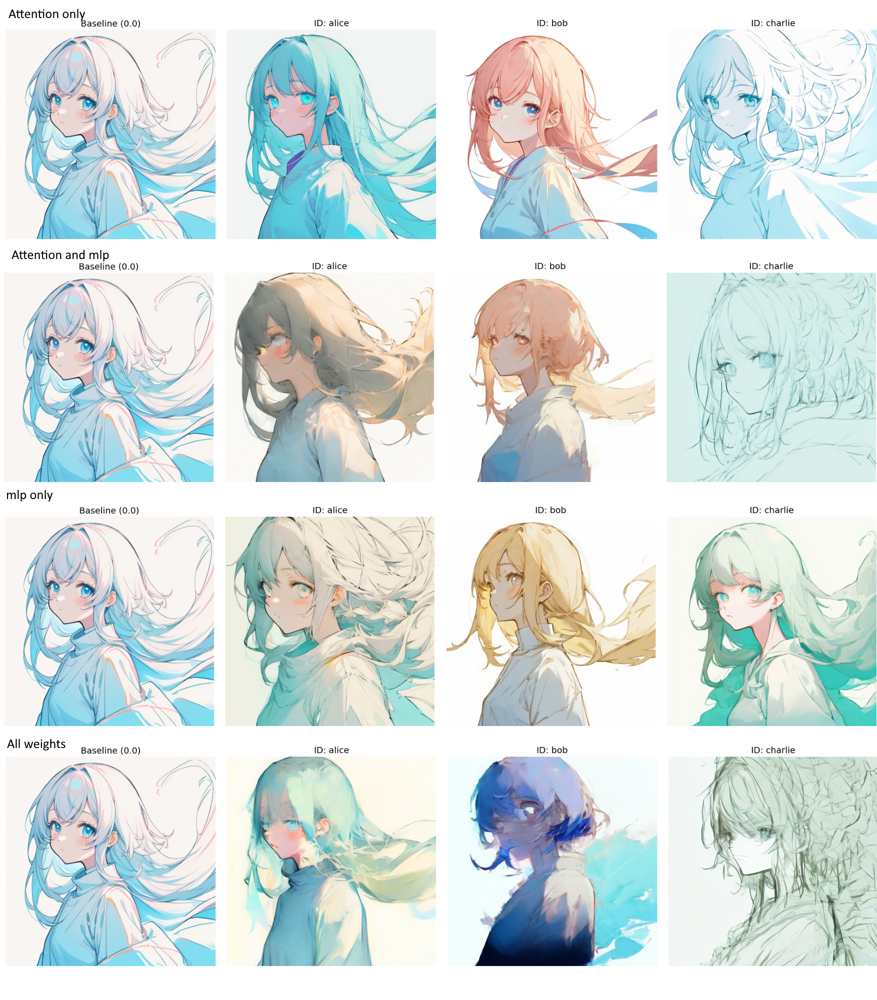

# ComfyUI Personality Warp

**与えた名前を基に画像生成AIに「個性」を与えます。プロンプトでは指定しきれない画風を安定して生成すること、没個性的になりがちなAI生成画像を個性的にする事で「AI臭さ」の削減を狙います。**
気に入った画風を引き当てるためには「名前ガチャ」を繰り返す必要がありますが、「別にこうしたいという狙いがあるわけじゃないけど、もちょっと個性的な絵が欲しい」時は適当な名前絵を入れればOK
そういう「ちょっといい絵が欲しい」層向けが主です

技術者的に言うと個性ID（`personality_id`）をシードとして拡散モデルの中間層パラメータに微小な決定論的摂動（ゆがみ）を加え、生成画像に一貫した「個性・クセ」を持たせる実験用 ComfyUI カスタムノードです。
計算した中間パラーメタを別IDから出したものと演算することで、個性の足し算や混ぜ合わせも可能でしょう(多分)

---

## 背景・仮説（Hypothesis）

> 「AI生成画像がいわゆる"AI臭い"均質な見た目になりがちなのは、モデルが『絵として破綻しない高次元ポテンシャルの緩やかな窪地（アトラクタ）』に毎回素直に落ちてしまうからではないか？」

同じプロンプト・同じ初期ノイズシード（`KSampler` の seed）のまま、モデルの**中間層（UNet の `middle_block` や DiT の中央ブロック付近の Attention / MLP 重み）**に `personality_id` 固有の微小な摂動 $\Delta W$ を加えてポテンシャル地形をわずかに歪めることで、破綻を防ぎつつ出力に固有のバイアス（個性）が生まれるかを検証します。

---

## サンプル比較（`Counterfeit-V3.0` / 同一プロンプト・同一シード）

`strength = 0.2`, `mode = low_rank`, `layer_start = 0.45`, `layer_end = 0.75` で、`target_part` ごとに **Baseline (0.0)** と **ID: `alice` / `bob` / `charlie`** を比較した例です：



* **Attention only**: 構図やキャラの造形を保ったまま、線画のタッチや色調の方向性が変化
* **Attention and mlp**: 絵柄・質感まで含めてより大胆な画風の変化が出現
* **mlp only**: 輪郭を保ちつつ、塗り・光・色味のニュアンスが変化
* **All weights**: インク・水彩・ラフスケッチ風など、最も大胆にポテンシャルから外れた表現

---

## 主な特徴

* **非破壊パッチ（`ModelPatcher.clone()` + `add_patches()`）**
  * 元のモデル重みを書き換えないため、1つのワークフロー内で「ベースライン（歪みなし）」「個性ID: A」「個性ID: B」を**同じ画像シードで並列比較**できます。
* **アーキテクチャ自動判別（UNet / DiT 両対応）**
  * SD1.5 / SDXL（UNet の `middle_block` や深層ブロック）だけでなく、FLUX / SD3 等の DiT 系ブロック構造にも対応。
* **3種類の摂動モード**
  * `low_rank`（デフォルト）: LoRA などの事後学習と同じ低ランク構造（$A B^\top$）の摂動を生成。高周波ノイズになりにくく、スタイル的な変化が出やすい設定です。
  * `gaussian`: 各層の重み標準偏差 $\sigma_W$ に比例した等方性ガウス摂動。
  * `rademacher`: $\pm 1$ の定ノルム摂動。
* **層ごとの相対スケーリング**
  * 摂動の大きさは各テンソルの標準偏差 $\sigma_W$ に比例してスケーリングされるため、`strength = 〜 0.5` 程度で効き具合を調整できます。

---

## インストール（ComfyUI）

```bash
cd ComfyUI/custom_nodes
git clone https://github.com/nonakaQubit/comfyui-personality-warp.git
```

追加の外部ライブラリは不要です（ComfyUI 本体の PyTorch のみで動作します）。ComfyUI を再起動すると、ノードメニューの `model_patches/experimental` → **`Personality Warp (Middle-Layer Perturbation)`** として追加されます。

---

## パラメータ説明

| パラメータ | 説明 | 目安 |
| :--- | :--- | :--- |
| `personality_id` | 個性を決める任意の文字列（例: `"alice"`, `"001"`）。同じIDなら常に同じ摂動を再現します。 | 任意 |
| `strength` | 歪みの強さ（各層の重み標準偏差に対する倍率）。`0.0` でバイパス。 | 大きいほど個性(歪み)が出ます。サンプルは `0.2`。大きくして、それでも「見える絵」を探すとより個性的な絵になると思われます |
| `mode` | `low_rank`（推奨）/ `gaussian` / `rademacher` | `low_rank` |
| `layer_scope` | `middle_only`（中央層のみ）/ `mid_band`（中間帯域）/ `custom_range` | `middle_only` |
| `target_part` | `attention_and_mlp` / `attention_only` / `mlp_only` / `all_weights` | `attention_and_mlp` |
| `rank` | `low_rank` モード時のランク数 | `4` |
| `layer_start` / `layer_end` | `custom_range` 選択時の開始・終了割合（`0.0` 〜 `1.0`）数字が小さいとより根本的に変わります | サンプルは `0.45` 〜 `0.95` |

---

## Google Colab での検証

`colab/personality_warp_poc.ipynb` を Google Colab で開くと、同じプロンプト・同じシードでの **ベースライン vs 複数の個性ID** の比較画像を自動生成できます。
